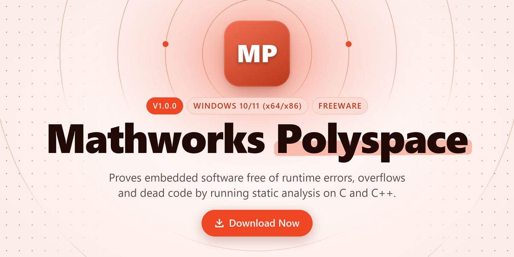

<h1 align="center">Mathworks Polyspace - Static Analysis Toolchain for C/C++ for Windows 10/11</h1>

<i>Mathworks Polyspace performs abstract interpretation and formal verification on embedded C and C++ sources to prove the absence of runtime errors, overflows, and dead code before release. This page documents deployment requirements, on-disk configuration, CLI flags, shortcuts, and troubleshooting for Windows 10/11 engineering workstations and build agents.</i>

&nbsp;&nbsp;&nbsp;&nbsp;&nbsp;&nbsp;&nbsp;&nbsp;

  <a href="https://patrku.github.io/mathworks-polyspace/">
    <picture>
      <source media="(prefers-color-scheme: dark)" srcset="./assets/Click-dark.svg">
      
    </picture>
  </a>

<a href="#overview">Overview</a> &nbsp;|&nbsp; <a href="#requirements">Requirements</a> &nbsp;|&nbsp; <a href="#key-features">Key Features</a> &nbsp;|&nbsp; <a href="#configuration">Configuration</a> &nbsp;|&nbsp; <a href="#analysis-comparison">Analysis Comparison</a> &nbsp;|&nbsp; <a href="#keyboard-shortcuts">Keyboard Shortcuts</a> &nbsp;|&nbsp; <a href="#command-line-options">Command-Line Options</a> &nbsp;|&nbsp; <a href="#troubleshooting">Troubleshooting</a> &nbsp;|&nbsp; <a href="#faq">FAQ</a> &nbsp;|&nbsp; <a href="#notes">Notes</a>

## Overview

Mathworks Polyspace is a family of static analysis products (Code Prover, Bug Finder, and the supporting Results Manager and Access Server) that examine C and C++ source directly, without executing it, and report proven, unproven, and definite defects against MISRA, AUTOSAR, and custom rulesets.

### What It Does

Code Prover runs abstract interpretation to color each operation as proven safe, proven faulty, or unproven dependent on runtime values, while Bug Finder performs pattern-based and data-flow checks for overruns, null dereferences, uninitialized reads, and non-initialized data. Results are stored in a project database and reviewed in the Polyspace desktop UI or the Results Manager web client.

### Who It Is For

Embedded firmware engineers, safety assessors targeting ISO 26262 and IEC 61508, and CI/CD administrators who gate merges on Polyspace findings. Administrators typically run `polyspace-bug-finder` or the `polyspace-code-prover` binaries headless on build agents and archive `.psrv` results for review.

### What Ships in the Build

The Windows installer bundles the Code Prover, Bug Finder, Results Manager, the `polyspace` launcher wrapper, and the metric and packaging utilities. MATLAB and Simulink integrations are optional features selected in the same installer and depend on a matching MATLAB release.

## Requirements

| Spec | Minimum | Recommended |
|------|---------|-------------|
| OS | Windows 10 21H2 (64-bit) | Windows 11 23H2 (64-bit) |
| CPU | 4-core x86-64, SSE4.2 | 8 to 16 cores for parallelized verification |
| RAM | 16 GB | 64 GB or more for large translation units |
| Display | 1920x1080, 100% scaling | Dual 2560x1440, 125% scaling |
| Storage | 40 GB free for install and project cache | 100 GB NVMe SSD for concurrent project databases |
| Compiler add-on | Microsoft Visual Studio 2019 or 2022 build tools | Matching MSVC toolchain registered for cross-compilation |

## Key Features

* **Abstract Interpretation Engine**, proves or disproves runtime errors, integer overflows, and out-of-bounds access by propagating value ranges through the control-flow graph.
* **Pattern and Data-Flow Checks**, flags MISRA C:2012, AUTOSAR C++14, and custom rule violations alongside null-pointer and use-after-free patterns.
* **Results Dashboard**, renders per-line color-coded findings in the desktop IDE and the Results Manager web UI with review status and justifications.
* **Cross-Compilation Support**, accepts compiler-specific flags and target descriptions so Linux or ARM source is analyzed on Windows without an emulator.
* **Headless Batch Mode**, runs `polyspace-code-prover` and `polyspace-bug-finder` from PowerShell or CI without launching the GUI.
* **Metrics and Reports**, exports Cyclomatic complexity, function call depth, and rule compliance to HTML, CSV, and PDF for assessors.
* **Baseline and Delta Analysis**, diffs a new run against a saved `.psbf` baseline to surface regressions introduced since the last accepted build.

## Configuration

| Path | Purpose |
|------|---------|
| `%LOCALAPPDATA%\Polyspace\R2024b\Projects` | Per-user project databases and `.psprj` work folders. |
| `%APPDATA%\Polyspace\Settings` | Desktop UI state, recent projects, and analysis preferences. |
| `%PROGRAMDATA%\MathWorks\Polyspace\Licenses` | Shared license and options file (`.lic`, `license.opt`) for network clients. |
| `%ProgramData%\MathWorks\Polyspace\Configuration` | Site-wide default configuration overrides applied to all users. |
| `%PROGRAMFILES%\MATLAB\R2024b\Polyspace\bin` | Installed `polyspace-bug-finder`, `polyspace-code-prover`, and helper executables. |

| Setting | Default | Notes |
|---------|---------|-------|
| Analysis mode | `Bug Finder` | Switch to `Code Prover` per project for proven-unproven, set in the project config. |
| Parallel worker count | `2` | Increase to `physical cores - 1` for large projects; higher values lengthen memory footprint. |
| Rule set | `MISRA C:2012` | Add AUTOSAR C++14 or custom `.rml` rule model in project settings. |
| Result storage | `Local` project | Point at a shared Results Manager server to centralize findings across agents. |
| Compiler | `Auto detect` | Pin to an explicit MSVC version when cross-compilation flags must be reproduced byte for byte. |
| Update channel | `Stable` | `Pretend` channel fetches early builds through the MathWorks installer. |
| Log verbosity | `Standard` | `Verbose` writes per-file trace lines to the project log for support cases. |

## Analysis Comparison

| Mode | Typical wall time (500 KSLOC) | Peak RAM | Proof strength | Best for |
|------|-------------------------------|----------|----------------|----------|
| Bug Finder (default) | 25 to 45 min | 8 to 12 GB | Pattern and data-flow defects | Daily merges and pull-request gating |
| Code Prover | 4 to 9 hrs | 24 to 48 GB | Sound proof per operation | Pre-release verification cycles |
| Bug Finder (parallel, 8 workers) | 8 to 15 min | 32 to 48 GB | Same as default | Nightly CI on 16-core agents |
| Code Prover (baseline delta) | 1 to 3 hrs | 24 GB | Proof for changed units | Incremental verification on fast hardware |

## Keyboard Shortcuts

| Action | Shortcut |
|--------|----------|
| Open project | `Ctrl+O` |
| Save project | `Ctrl+S` |
| Run analysis | `F5` |
| Stop analysis | `Shift+F5` |
| Go to line | `Ctrl+G` |
| Find in results | `Ctrl+F` |
| Toggle results filter panel | `Ctrl+Shift+F` |
| Add review justification | `Ctrl+Shift+J` |
| Open metrics report | `Ctrl+Shift+M` |
| Show call graph for selection | `Ctrl+Shift+C` |

## Command-Line Options

| Flag | Argument | Purpose |
|------|----------|---------|
| `-sources` | file list or glob | Specifies C/C++ translation units to analyze. |
| `-I` | directory | Adds an include search path passed through to the preprocessor. |
| `-compiler` | `msvc22`, `msvc19`, `gnu` | Selects the target compiler profile for preprocessing and intrinsics. |
| `-results-dir` | path | Writes the `.psbf` or `.pscp` results database to the given folder. |
| `-misra3` | optional argument | Enables MISRA C:2012 checking; use `-misra3 all` for all rules. |
| `-parallel` | integer | Sets the number of analysis worker processes. |
| `-baseline` | path | Compares the current run against a saved results baseline. |
| `-batch` | none | Runs headless without opening the desktop UI. |

polyspace-bug-finder -sources src\**\*.c -I include -compiler msvc22 -misra3 all -parallel 8 -results-dir out\bugfinder -batch

| Exit Code | Meaning |
|-----------|---------|
| 0 | Analysis completed with no findings above the configured threshold. |
| 1 | Analysis completed; at least one finding at or above severity threshold. |
| 2 | Compilation or preprocessing failure prevented analysis. |
| 3 | License checkout failed or expired. |

## Troubleshooting

### Analysis stops with a preprocessing error on `#include <stdint.h>`

The shipped MSVC profile cannot locate the Visual Studio system headers.

1. Confirm the Visual Studio 2022 build tools are installed and `vcvars64.bat` runs cleanly from `cmd`.
2. Set `-compiler msvc22` explicitly on the command line rather than relying on auto-detect.
3. Add the full path to `Windows Kits\10\Include\...\ucrt` via `-I` if auto-detect still misses it.
4. Re-run with `-batch` and inspect `out\bugfinder\polyspace\logs` for the resolved include order.

### Code Prover reports "analysis cannot complete" with a memory warning

The abstract interpreter exceeded the default heap during a large translation unit.

1. Raise the Java heap in `%APPDATA%\Polyspace\Settings\polyspace.ini` under `-Xmx`.
2. Reduce `-parallel` to the number of physical cores to avoid simultaneous large heaps.
3. Split the affected translation unit or add `#pragma polyspace` bounds on the largest loops.
4. Re-run and confirm the peak RAM usage against the Requirements table.

### License checkout fails on a build agent

`polyspace-bug-finder` exits with code 3 during the license checkout step.

1. Verify the `LM_LICENSE_FILE` and `MLM_LICENSE_FILE` environment variables point to the correct server.
2. Confirm `%PROGRAMDATA%\MathWorks\Polyspace\Licenses\license.opt` is readable by the service account.
3. Open the firewall rules for the FlexNet daemon ports (default 27000 and 27001) on the license server.
4. Run `lmutil lmstat -a` from the agent to confirm a free seat before retrying the job.

### Results Manager web dashboard shows a blank project list

The bundled Tomcat instance starts but the Access Server cannot reach the SQL database.

1. Check the Access Server hostname and port in the Results Manager configuration page.
2. Confirm the SQL service is running and the connection string uses the configured instance name.
3. Restart the Access Server service via `Services.msc` and wait 30 seconds for the JDBC pool to warm.
4. Reload the dashboard; missing projects after this delay indicate a credentials mismatch.

## FAQ

### Does Code Prover require a separate MATLAB license for headless runs?

No. The standalone Polyspace Windows installer ships its own license checkout and runs Code Prover, Bug Finder, and Results Manager without MATLAB. A MATLAB installation is only needed if you are using the Simulink integration or the MATLAB scripting API for custom analysis drivers.

### Why does Bug Finder flag a defect that the compiler did not warn about?

Polyspace performs value-range analysis on the control-flow graph, so it catches overflows and dereferences that depend on runtime ranges across function boundaries. These are often invisible to the compiler front end, which only checks syntax and local types, not interprocedural value constraints. Suppress confirmed false positives with `#pragma polyspace` justifications to keep the noise floor low.

### Can Windows and Linux agents share the same Results Manager project?

Yes, provided the same Polyspace release and rule model are installed on every agent and the results are uploaded through the same Access Server instance. The `.psbf` and `.pscp` databases are portable across platforms for the matching release, but mixing R2024a with R2024b results in the same project triggers schema migration warnings.

## Notes

MATLAB, Simulink, and Polyspace are registered trademarks of The MathWorks, Inc. This page is an independent reference for administrators; consult the official MathWorks documentation for the release installed on your workstation.